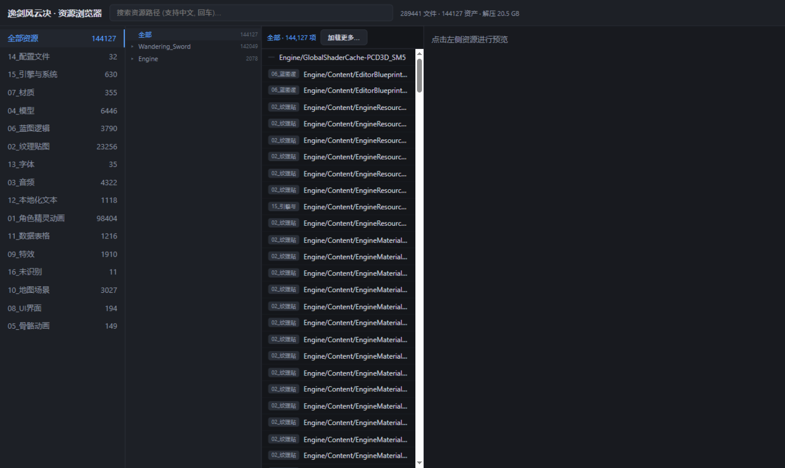
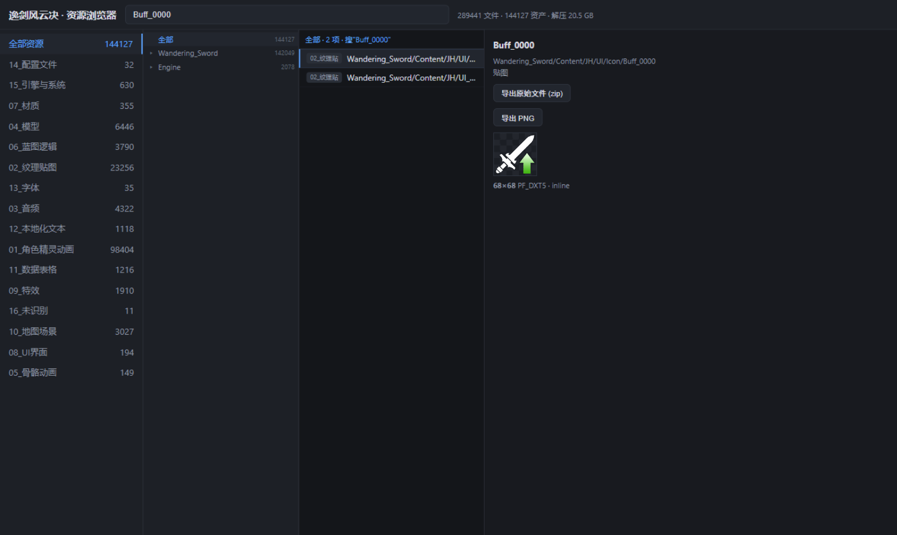
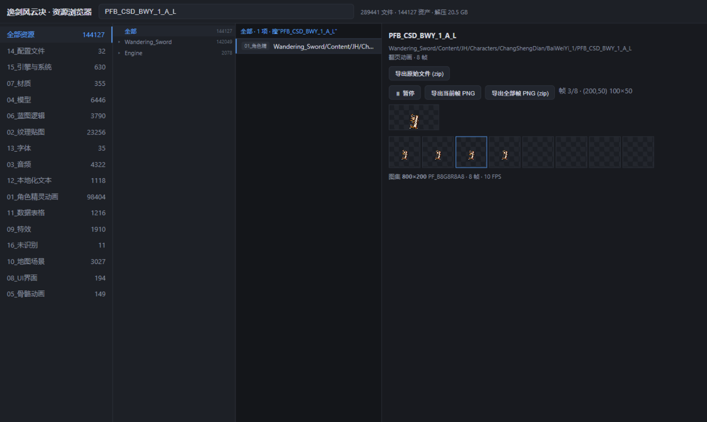
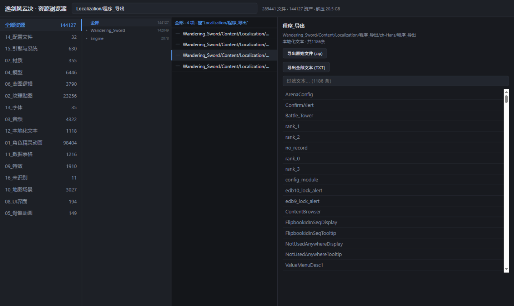
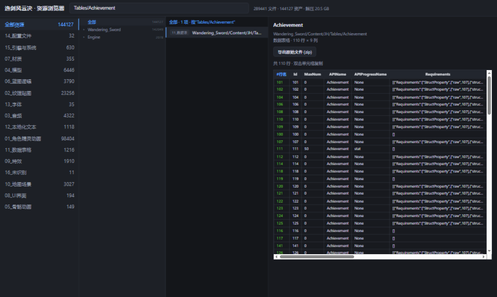
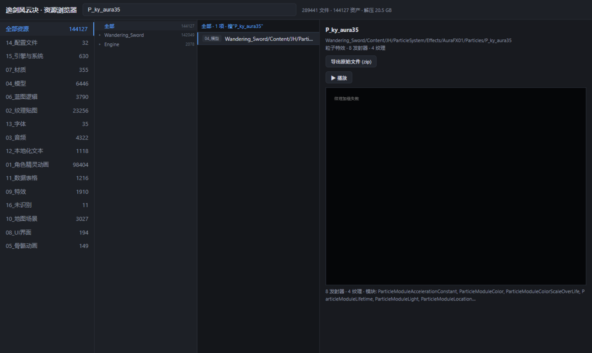

<div align="center">

# 逸剑风云决 · 游戏资源浏览器

*Wandering Sword Game Resources Browser*

基于纯逆向的自定义 UE4 pak/uasset 格式解析器，直接从游戏资源包浏览、预览、导出资源


 


**本仓库只包含工具代码，不包含任何游戏资源文件**

</div>

---

## ⚠️ 仅供查看声明

> 本工具**仅供个人学习、研究与资源查看用途**。游戏的全部资源版权归
> 《逸剑风云决》开发商及发行商所有。请勿将提取出的游戏资源用于二次分发、
> 商业用途或任何侵犯版权的行为。因不当使用产生的后果由使用者自行承担。
> 如开发商提出要求，本仓库将及时处理。

---

## ✨ 功能

| 功能 | 说明 |
|---|---|
| 🔍 全量索引 | 直接解析 5.95GB 自定义 v11 pak：289,441 个文件 / 144,895 个资产，秒级加载 |
| 📂 分类 + 目录树 | 16 个资源分类 + 多级目录树筛选（任意层级、与搜索叠加组合） |
| 🖼️ 贴图预览 | DXT1/DXT3/DXT5/BC4/BC5/未压缩格式浏览器端直接解码（位级校验一致） |
| 🎬 动效播放 | PaperFlipbook 翻页动画逐帧预览与自动播放，含帧坐标 |
| 🎵 音频播放 | SoundWave (OGG) 页面内直接播放 |
| 📖 剧情文本 | .locres 本地化文本全量浏览与过滤（含全部中文文本） |
| 📊 数据表格 | DataTable 真实表格预览（行×列、双击复制） |
| 🧊 模型预览 | Static/Skeletal Mesh 顶点点云 3D 预览（拖动旋转/缩放） |
| ✨ 粒子特效 | ParticleSystem 材质纹理链解析 + 实时粒子模拟（SubUV 图集动画/加法混合） |
| 📦 多格式导出 | PNG / OGG / TXT / 全帧 zip / 原始 uasset+uexp zip |
| 🛠️ 资源替换 | 补丁 pak 秒级打包（放游戏 Paks 目录即生效）或完整 pak 重建 |

## 📸 运行截图

### 主界面 —— 分类 · 目录树 · 资源列表


### 贴图预览 —— DXT 压缩纹理直接解码


### 动效预览 —— PaperFlipbook 翻页动画播放


### 剧情文本 —— 本地化文本浏览与过滤


### 数据表格 —— DataTable 真实表格预览（110+ 张游戏数值表）


### 粒子特效 —— 实时粒子模拟预览（纹理图集 + 发射器参数）


## 🚀 快速开始

### 环境要求

- Windows + **Python 3.8+**（需含 tkinter，官方安装包默认自带）
- 游戏资源包 `Wandering_Sword-WindowsNoEditor.pak` 放在本工具同目录（**仓库不含，自行从自己的游戏副本获取**）

### 一键安装（人 / AI 通用）

```bash
git clone https://github.com/masterball-w/wondering_sword-GameResourcesBrowser.git
cd wondering_sword-GameResourcesBrowser
pip install -r requirements.txt
# 把 Wandering_Sword-WindowsNoEditor.pak 放到本目录, 然后启动:
python 资源浏览器.pyw
```

### 🤖 AI 一键安装命令（可直接复制给 AI 助手执行）

```text
git clone https://github.com/masterball-w/wondering_sword-GameResourcesBrowser.git && cd wondering_sword-GameResourcesBrowser && pip install -r requirements.txt && python 资源浏览器.pyw
```

> 核心功能零第三方依赖，`requirements.txt` 仅含可选的逆向分析库；即使不装也能直接运行浏览器与替换工具。

### 使用

| 工具 | 用途 |
|---|---|
| `资源浏览器.pyw` | 双击启动，自动打开 `http://127.0.0.1:8738` |
| `资源替换工具.pyw` | tkinter 界面：导出资源 → 修改 → 打补丁 pak / 重建完整 pak |

详见 [使用说明.md](使用说明.md)。

## 🗂️ 项目结构

```
├── 资源浏览器.pyw          # Web 资源浏览器（HTTP 服务 + 内嵌前端，含 DXT 解码器）
├── 资源替换工具.pyw        # 资源替换 GUI（补丁 pak / 完整重建）
├── requirements.txt        # 依赖（核心零依赖，仅可选分析库）
├── 使用说明.md             # 详细使用文档
├── screenshots/            # 运行截图
└── tools/
    ├── paklib.py           # 自定义 v11 pak 解析/写入库（逆向格式）
    ├── uasset.py           # 自定义 cooked uasset 属性解析器（逆向格式）
    ├── assetdb.py          # 资源分析层（pak 直读 + 预览数据生成）
    ├── texdec.py           # 服务端纹理解码 + PNG 编码（纯标准库）
    ├── extract_all.py      # 全量解压脚本
    └── categorize.py       # 分类脚本（默认仅索引）
```

## 🔬 逆向格式说明

游戏使用**非标准 UE4 v11 pak 与 cooked uasset**（与原版 UE 差异显著），全部格式细节见
[`tools/paklib.py`](tools/paklib.py) 与 [`tools/uasset.py`](tools/uasset.py) 头部注释。
要点：压缩数据 SHA1、method=0 省略 size 字段、属性值前导字节、bulk 头 20 字节布局、
DXT 索引 32 位字读取等，均经与基准解码器位级比对验证。

## 📄 版权

工具代码仅供学习研究。游戏《逸剑风云决》(Wandering Sword) 及其全部资源版权归原开发商/发行商所有，本仓库与原作者无关联。

<div align="center">

**如果这个工具对你有帮助，欢迎点一个 ⭐ Star**

</div>
